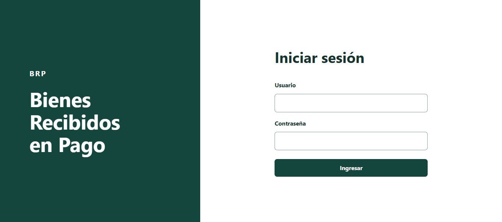
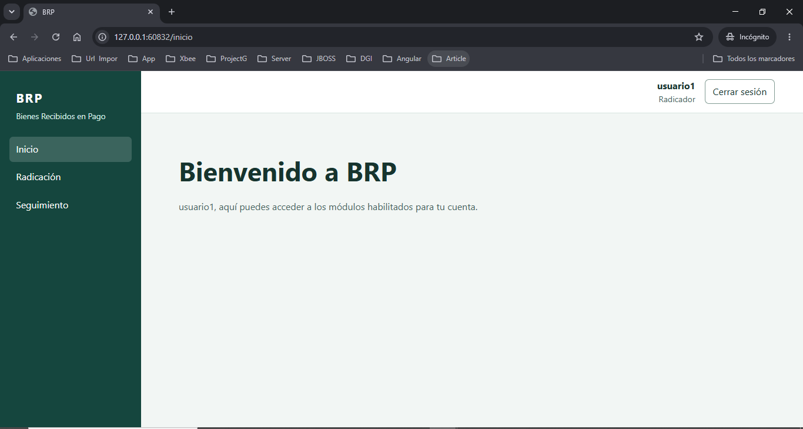
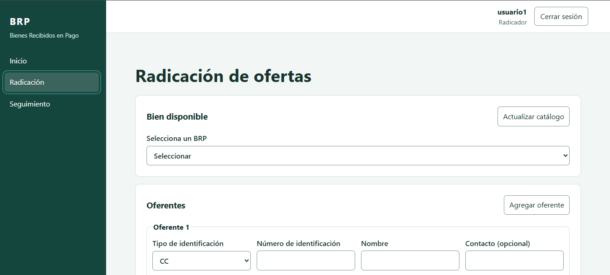
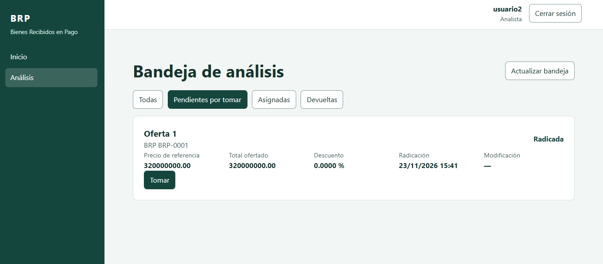
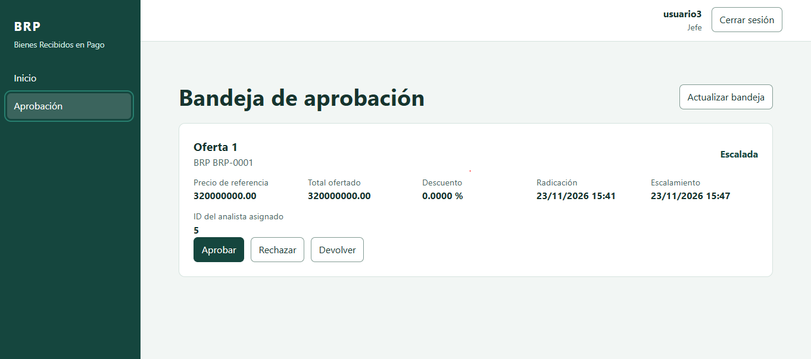
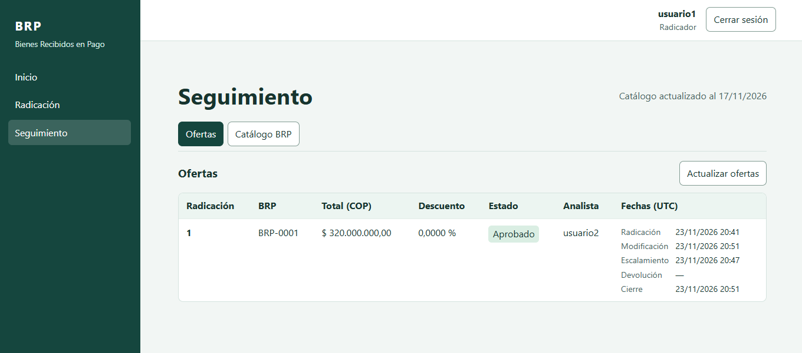

# BRP · Gestión de ofertas sobre bienes recibidos en pago

BRP permite administrar usuarios y permisos, radicar ofertas sobre bienes
disponibles, analizarlas, decidirlas y consultar su trazabilidad. Spring
Boot aplica las reglas del negocio y Angular presenta las opciones
habilitadas para cada usuario.

<details>
<summary>Ver capturas del sistema</summary>

### 1. Inicio de sesión



### 2. Panel de inicio



### 3. Radicación



### 4. Análisis



### 5. Aprobación



### 6. Seguimiento



</details>

## Tecnologías usadas

| Área                          | Tecnologías                                                                |
| ----------------------------- | -------------------------------------------------------------------------- |
| Backend                       | Java 25, Spring Boot 4.0.10, Spring MVC, Spring Data JPA y Bean Validation |
| Frontend                      | Angular 20.3, TypeScript 5.9, RxJS, Angular Router y formularios reactivos |
| Datos                         | PostgreSQL 17 y migraciones Liquibase                                      |
| Seguridad                     | Spring Security, BCrypt y JWT                                              |
| Compilación e infraestructura | Gradle Wrapper, npm, Angular CLI local y Docker Compose                    |

## Requisitos para ejecutar el proyecto

- Git y Git Bash para seguir los comandos de esta guía en Windows.
- Docker Desktop en ejecución con Docker Compose para levantar PostgreSQL.
- JDK 25 para ejecutar Spring Boot localmente.
- Node.js y npm para ejecutar Angular localmente. La guía utiliza Node.js
  20.19.6 y npm 10.8.2. El repositorio incluye el Gradle Wrapper y el proyecto
  frontend instala su propio Angular CLI.
- Puertos locales disponibles: `55432` para PostgreSQL, `8080` para Spring Boot
  y `4200` para Angular en la configuración predeterminada.
- Un archivo `.env` local y un hash BCrypt para inicializar el administrador
  en una base nueva. La guía de arranque explica cómo prepararlos.

## Guía del proyecto

- [Arranque local en Windows](#arranque-local-en-windows-con-git-bash)
- [Solución de errores en Windows](#solución-de-errores-en-windows)
- [Datos y usuarios de prueba](#datos-y-usuarios-de-prueba)
- [¿Cómo ingreso?](#cómo-ingreso) y [Crear usuario](#crear-usuario)
- [Guion de demostración](#guion-de-demostración)
- [Diseño y decisiones de la entrega](#diseño-y-decisiones-de-la-entrega)
- [API de identidad](#api-de-identidad), [adjuntos](#api-de-adjuntos) y [pruebas](#pruebas-de-integración)

## Arranque local en Windows con Git Bash

Abre Docker Desktop. PostgreSQL se ejecuta en Docker y puedes arrancar
Spring Boot y Angular en terminales locales.

| Servicio    | Dirección local predeterminada |
| ----------- | ------------------------------ |
| PostgreSQL  | `127.0.0.1:55432`              |
| Spring Boot | `127.0.0.1:8080`               |
| Angular     | `127.0.0.1:4200`               |

### 1. Preparar `.env` e iniciar PostgreSQL

Desde la raíz del repositorio, ajusta la ruta si clonaste en otro lugar.
Si ya existe `.env`, conserva los datos con los que inicializaste el
volumen. En una instalación nueva, este bloque crea el archivo con una
contraseña generada. En ambos casos comprueba que Git ignore el archivo.

```bash
cd /d/REPOS/brp-java-angular-mvp
git check-ignore -q .env && node.exe -e '
const fs = require("node:fs");
const { randomBytes } = require("node:crypto");
if (!fs.existsSync(".env")) {
  const example = fs.readFileSync(".env.example", "utf8");
  const contents = example.replace(/^POSTGRES_PASSWORD=.*$/m,
    "POSTGRES_PASSWORD=" + randomBytes(24).toString("hex"));
  fs.writeFileSync(".env", contents, { flag: "wx" });
}
console.log("Configuración local de PostgreSQL disponible.");
' &&
docker compose up -d --wait postgres &&
docker compose ps postgres
```

Continúa solo si aparece el mensaje de configuración local y espera el
estado `healthy`. Si PostgreSQL ya está saludable en ese
contenedor, puedes pasar al siguiente paso. Cambiar `POSTGRES_PASSWORD`
en el archivo no cambia la contraseña del volumen inicializado.

### 2. Configurar la clave JWT local

Desde la raíz, ejecuta el bloque. Usa `node.exe -e` para evitar el
problema de entrada interactiva de Git Bash. Una clave local válida se
conserva. El comando comprueba la longitud en bytes sin imprimirla.

```bash
git check-ignore -q .env && node.exe -e '
const fs = require("node:fs");
const file = ".env";
const lines = fs.readFileSync(file, "utf8").split(/\r?\n/);
const entry = /^\s*BRP_JWT_SECRET_BASE64\s*=/;
const existing = lines.findLast(line => entry.test(line))?.replace(entry, "").trim();
const bytes = Buffer.from(existing ?? "", "base64");
const valid = bytes.length >= 32 && bytes.toString("base64") === existing;
const key = valid ? existing : require("node:crypto").randomBytes(32).toString("base64");
const contents = lines.filter(line => !entry.test(line)).join("\n").trimEnd();
fs.writeFileSync(file, contents + "\nBRP_JWT_SECRET_BASE64=" + key + "\n");
console.log("Clave JWT local configurada.");
'
unset BRP_JWT_SECRET_BASE64
```

El perfil `dev` lee esta clave desde `.env`. El `unset` evita que una
variable anterior de la terminal prevalezca sobre ese archivo.

### 3. Preparar el administrador inicial

Haz este paso si el primer arranque aún debe aplicar Liquibase 005. El
nombre de usuario es `admin` y la contraseña de prueba es la que elijas
al generar su hash. Conserva esa contraseña por separado.

```bash
docker run --rm -it httpd:2.4-alpine htpasswd -nBC 12 admin
```

Este comando es un auxiliar puntual para generar BCrypt. En Git Bash,
si devuelve `the input device is not a TTY`, antepón `winpty` al comando
o ejecuta el generador desde CMD. Luego vuelve a Git Bash. Copia el hash
que aparece después de `admin:`, desde el primer `$` hasta el final,
y pégalo cuando `read` lo solicite.

```bash
read -rsp 'Pega el hash BCrypt sin el prefijo admin: ' BRP_BOOTSTRAP_ADMIN_HASH
printf '\n'
export BRP_BOOTSTRAP_ADMIN_HASH
node.exe -e 'const h=process.env.BRP_BOOTSTRAP_ADMIN_HASH||""; if (!/^[$]2[aby][$](0[4-9]|[12][0-9]|3[01])[$][./A-Za-z0-9]{53}$/.test(h)) { console.error("Hash BCrypt ausente o inválido"); process.exit(1); } console.log("Formato BCrypt correcto");'
```

Liquibase obtiene el hash directamente del entorno del proceso. Arranca
Gradle desde esta misma terminal. Si el administrador ya fue creado,
puedes omitir este paso. Cambiar el hash de arranque después de aplicar
la migración no cambia la contraseña existente.

### 4. Arrancar Spring Boot y Angular

En la terminal de arranque del backend, desde la raíz:

```bash
cd backend
./gradlew --no-daemon --console=plain bootRun --args="--spring.profiles.active=dev"
```

En otra terminal, desde la raíz:

```bash
cd frontend
npm i
npm start
```

Si Angular ya está activo, reutiliza ese proceso. `npm ci` se necesita
al instalar por primera vez o al cambiar el lockfile. Desde otra terminal,
verifica la conexión directa y el proxy:

```bash
curl -fsS http://127.0.0.1:8080/actuator/health
curl -fsS http://127.0.0.1:4200/api/health
```

Ambas respuestas deben incluir `"status":"UP"`. Abre
[BRP](http://localhost:4200) o [Diagnóstico](http://localhost:4200/diagnostico).
Usa `admin` y la contraseña original elegida para el administrador.

Para detener Angular y Spring Boot, pulsa `Ctrl+C` en sus terminales.
Desde la raíz, `docker compose stop postgres` detiene la base conservando
su volumen.

### Solución de errores en Windows

| Mensaje o síntoma                                                      | Qué hacer                                                                                                                                      |
| ---------------------------------------------------------------------- | ---------------------------------------------------------------------------------------------------------------------------------------------- |
| `BRP_JWT_SECRET_BASE64 requiere una clave Base64 de al menos 32 bytes` | Ejecuta el paso 2, haz `unset BRP_JWT_SECRET_BASE64` y vuelve a arrancar desde `backend` con el perfil `dev`. Es un error de firma JWT.        |
| `Se requiere un hash BCrypt válido en BRP_BOOTSTRAP_ADMIN_HASH`        | Pega el hash completo generado para `admin`, sin el prefijo, comillas ni espacios. Comprueba el formato y ejecuta Gradle en la misma terminal. |
| `stdin is not a tty` al pasar un bloque a `node`                       | Usa el bloque con `node.exe -e` del paso 2. No lo sustituyas por `node <<'NODE'` si `node` usa un alias interactivo.                           |
| Angular carga pero `/api/health` devuelve `500`                        | Verifica primero `/actuator/health` en `8080`. Si Spring no está disponible, revisa la última línea `Caused by` de Gradle.                     |
| PostgreSQL rechaza las credenciales                                    | Confirma que el contenedor esté saludable y que `.env` use las credenciales originales de su volumen.                                          |
| `4200` u `8080` ocupado                                                | Identifica el proceso. Reutiliza el servicio BRP si ya está activo o detén el proceso correspondiente antes de arrancar otro.                  |

### Alternativa con los tres servicios en Docker

La configuración [Compose frontend](compose.frontend.yml) empaqueta la
demo sin instalar Node.js en el equipo anfitrión. Si es una instalación
nueva, copia `.env.example` a `.env` y configura una contraseña local de
PostgreSQL. Para un entorno nuevo sin clave JWT, Git Bash puede generar
una con OpenSSL mediante
`export BRP_JWT_SECRET_BASE64="$(openssl rand -base64 32)"`.
Para un entorno existente, conserva la clave configurada. El overlay exige que
`BRP_BOOTSTRAP_ADMIN_HASH` esté definida al resolver Compose, incluso
si la base ya migró. Exporta el hash en la terminal que ejecuta Compose.
Antes de cambiar de modo, detén los procesos
locales y el servicio PostgreSQL local con `docker compose stop postgres`.

```bash
docker compose -f docker-compose.yml -f compose.frontend.yml config --quiet
docker compose -f docker-compose.yml -f compose.frontend.yml up -d --build
```

La entrada es [Nginx en 8088](http://127.0.0.1:8088). PostgreSQL y Spring
se comunican por la red interna. El build íntegro del backend dentro de
Docker quedó pendiente de verificar tras errores de descarga de Gradle
y Maven Central. La imagen Angular y la comunicación mediante Nginx se
verificaron utilizando el JAR del backend compilado en Windows.

## Uso de la aplicación

### Sesión y navegación Angular

La raíz abre `/inicio` con una sesión válida y `/login` cuando hace falta identificarse. Angular conserva el JWT en `sessionStorage` y valida el usuario activo con `GET /api/auth/me` al iniciar sesión y recargar la pestaña. La sesión se limpia al cerrar sesión, expirar el token o recibir un `401` de una solicitud autenticada. Un `403` conserva la sesión.

El menú y las rutas aplican las combinaciones de rol y módulo del [contrato de autenticación](docs/frontend-auth-contract.md). Las rutas de los módulos futuros indican que la interfaz funcional sigue pendiente. `/diagnostico` sigue disponible para comprobar conectividad.

### Radicación desde Angular

Inicia sesión como radicador con el módulo `RADICACION` y abre **Radicación**. Selecciona un bien del catálogo vigente, registra entre uno y cinco oferentes y añade entre uno y seis pagos por oferente. Puedes introducir decimales con coma o punto. El formulario valida los importes y participaciones sin redondearlos.

**Consultar descuento** obtiene la vista previa del servidor. **Radicar oferta** envía los oferentes y pagos. La confirmación muestra el número de radicación y los valores definitivos devueltos por el backend. Si el BRP deja de estar disponible, actualiza el catálogo y selecciona un bien vigente.

### Análisis desde Angular

Inicia sesión como analista con el módulo `ANALISIS` y abre **Análisis**. La bandeja distingue las ofertas pendientes por tomar, las asignadas al usuario y las devueltas por el jefe. Tras tomar una oferta, puedes escalarla o rechazarla con confirmación. Si otra operación cambia la oferta, la bandeja se actualiza y puedes decidir de nuevo con la versión vigente.

### Aprobación desde Angular

Inicia sesión como jefe con el módulo `APROBACION` y abre **Aprobación**. La bandeja muestra las ofertas escaladas y permite confirmar su aprobación, rechazo o devolución al analista asignado. El resultado muestra la fecha de cierre o devolución informada por el servidor. Si otro usuario modifica la oferta, la bandeja se recarga y puedes decidir de nuevo con la información vigente.

### Seguimiento desde Angular

Abre **Seguimiento** con una cuenta activa que tenga el módulo
`SEGUIMIENTO`. **Ofertas** presenta la trazabilidad en UTC y **Catálogo
BRP** muestra los bienes vigentes, su estado y su precio si existe. El
encabezado muestra la última ingesta global. Los listados mantienen el
alcance y el orden del servidor.

La interfaz conserva el literal decimal del JSON cuando el navegador lo
proporciona. En los demás navegadores, rechaza la respuesta si algún
importe o descuento tiene una magnitud de 100.000.000.000 o mayor. Así
evita presentar cifras redondeadas sin aviso.

## Datos y usuarios de prueba

Liquibase carga el catálogo desde [brp_ejemplo.csv](docs/source/brp_ejemplo.csv)
al arrancar el backend. Se esperan 100 códigos ficticios y, para el CSV
entregado, 56 versiones vigentes disponibles para radicar. La fecha de
ingesta más reciente es el 17 de noviembre de 2026. Los cambios aplicados
quedan registrados por Liquibase para evitar repetir la carga al reiniciar.

Liquibase crea `admin` activo con el módulo `ADMINISTRACION`. La
contraseña de prueba la define quien prepara la instalación en el paso 3.
No hay contraseña de administrador versionada. Las siguientes cuentas
se preparan desde la pantalla de Administración:

| Login de prueba    | Rol         | Módulos                     |
| ------------------ | ----------- | --------------------------- |
| `prueba.radicator` | `RADICADOR` | `RADICACION`, `SEGUIMIENTO` |
| `prueba.analista`  | `ANALISTA`  | `ANALISIS`, `SEGUIMIENTO`   |
| `prueba.jefe`      | `JEFE`      | `APROBACION`, `SEGUIMIENTO` |

### ¿Cómo ingreso?

1. Abre [el login de BRP](http://localhost:4200/login).
2. Escribe `admin` como **Usuario** y, en **Contraseña**, usa la que
   escribiste al generar el hash BCrypt del administrador inicial.
3. Pulsa **Ingresar**. El menú debe mostrar **Administración**.

El login recibe la contraseña original. El hash BCrypt y la clave JWT se
usan al configurar el backend. Si no puedes ingresar, verifica primero
que [Spring Boot esté en UP](http://127.0.0.1:8080/actuator/health).
Si está en `UP` y rechaza la contraseña, usa la contraseña con la que se
creó la cuenta. Generar otro hash no cambia la contraseña de un
administrador existente.

### Crear usuario

1. Entra como `admin` y abre **Administración → Crear usuario**.
2. Escribe **Radicador de prueba** como nombre, `prueba.radicator` como
   login, una contraseña local de al menos ocho caracteres y selecciona
   el rol `RADICADOR`.
3. Pulsa **Crear usuario**. La cuenta nace activa y sin módulos. Con la
   cuenta seleccionada en **Rol y módulos**, pulsa **Conceder** por
   separado en **Radicación** y **Seguimiento**.
4. Cierra sesión e ingresa con `prueba.radicator` y la contraseña que
   elegiste. El menú debe mostrar **Radicación** y **Seguimiento**.

Para completar el recorrido, vuelve a ingresar como `admin` y repite
el alta para `prueba.analista` y `prueba.jefe` con los roles y módulos
de la tabla. Cambiar el rol de una cuenta no le concede módulos.

## API y adjuntos

### API de identidad

| Método y ruta                                                                                 | Operación                                                                       |
| --------------------------------------------------------------------------------------------- | ------------------------------------------------------------------------------- |
| `POST /api/auth/login`                                                                        | Recibe `login` y `password`. Devuelve `accessToken`, `tokenType` y `expiresIn`. |
| `GET /api/auth/me`                                                                            | Identidad, rol y módulos vigentes.                                              |
| `POST /api/admin/users`                                                                       | Alta con `name`, `login`, `password` y `role`.                                  |
| `GET /api/admin/users`, `GET /api/admin/users/{id}`                                           | Consultar lista o detalle.                                                      |
| `PATCH /api/admin/users/{id}/role`                                                            | Cambiar rol con `{"role":"ANALISTA"}`.                                          |
| `PATCH /api/admin/users/{id}/status`                                                          | Activar o desactivar con `{"active":false}`.                                    |
| `GET /api/admin/modules`, `GET /api/admin/users/{id}/modules`                                 | Consultar módulos disponibles o asignados.                                      |
| `PUT /api/admin/users/{id}/modules/{module}`, `DELETE /api/admin/users/{id}/modules/{module}` | Asignar o retirar un módulo.                                                    |

```bash
read -rsp 'Contraseña de admin: ' brp_password
printf '\n'
access_token=$(
  set -o pipefail
  BRP_API_PASSWORD="$brp_password" node.exe -e '
    process.stdout.write(JSON.stringify({login:"admin",password:process.env.BRP_API_PASSWORD}));
  ' |
    curl -fsS http://127.0.0.1:8080/api/auth/login \
      -H 'Content-Type: application/json' --data-binary @- |
    node.exe -e 'process.stdout.write(JSON.parse(require("node:fs").readFileSync(0,"utf8")).accessToken)'
)
unset brp_password
if [ -n "$access_token" ]; then
  curl -fsS http://127.0.0.1:8080/api/auth/me -H "Authorization: Bearer $access_token"
  curl -fsS http://127.0.0.1:8080/api/admin/modules -H "Authorization: Bearer $access_token"
fi
unset access_token
```

El JWT dura 15 minutos. El servidor exige `iat` y `exp`, aplica un máximo de
900 segundos entre ambos y admite hasta cinco segundos de adelanto en
`iat` por desfase de reloj. Salud y login ignoran el encabezado Bearer.
Todas las operaciones administrativas exigen el
rol `ADMINISTRADOR` y el módulo `ADMINISTRACION` vigentes. Una restricción
de negocio, como intentar retirar el acceso administrativo propio, se
responde con `409`. Aplica HTTPS fuera del entorno local y no habilites
trazas de credenciales, parámetros SQL ni tokens.

El login devuelve `429` cuando se agota el cupo de la ventana para la IP
remota o para toda la instancia. Los intentos válidos en formato cuentan
independientemente de si la cuenta existe o la contraseña es correcta.

| Variable de entorno                     | Valor inicial              |
| --------------------------------------- | -------------------------- |
| `BRP_IDENTITY_LOGIN_MAX_ATTEMPTS`       | 10 intentos por IP         |
| `BRP_IDENTITY_LOGIN_MAX_TOTAL_ATTEMPTS` | 120 intentos por instancia |
| `BRP_IDENTITY_LOGIN_WINDOW`             | `PT1M`, un minuto          |

El contador usa memoria local de la instancia, acotada por el límite
global. Se reinicia al vencer la ventana o reiniciar la aplicación. La
ventana es fija y permite ráfagas al consumir un cupo justo antes del
corte y el siguiente justo después.

La IP se obtiene de la conexión que reporta el servidor. La aplicación
no toma `X-Forwarded-For` directamente de la solicitud. Si el servidor
recibe la IP del proxy o balanceador, varios usuarios compartirán el
cupo. Antes de desplegar detrás de un proxy, configura una cadena de
proxies de confianza que sanee los encabezados reenviados, o aplica el
límite en el gateway. En despliegues multinodo se necesita un limitador
compartido o un gateway.

### API de radicación

Usa el JWT de un usuario activo con rol `RADICADOR` y módulo
`RADICACION`. Envía el token como `Authorization: Bearer <token>`.

| Método y ruta                       | Operación                                                                                                                                                           |
| ----------------------------------- | ------------------------------------------------------------------------------------------------------------------------------------------------------------------- |
| `GET /api/offers/catalog`           | Lista BRP disponibles para seleccionar al radicar, ordenados por código. Cada elemento incluye código, tipo, descripción, ubicación y precio de referencia vigente. |
| `POST /api/offers`                  | Recibe `brpCode` y `bidders`. Devuelve `201` con el número de radicación y el resumen calculado por el servidor.                                                    |
| `POST /api/offers/discount-preview` | Recibe `brpCode` y `total`. Devuelve precio de referencia, importe, descuento e indicador de sobreprecio sin guardar una oferta.                                    |
| `GET /api/offers/mine`              | Devuelve resúmenes de las ofertas propias, de la más reciente por número de radicación a la más antigua.                                                            |
| `GET /api/offers/mine/{number}`     | Devuelve el resumen, los oferentes y sus pagos. Una oferta inexistente o ajena devuelve `404`.                                                                      |

El catálogo de selección usa `RADICACION` y muestra solo bienes cuya
última versión está `DISPONIBLE`. La pestaña de catálogo de seguimiento
usa `GET /api/follow-up/catalog` y exige `SEGUIMIENTO`.

Ejemplo de cuerpo para radicar:

```json
{
  "brpCode": "BRP-0001",
  "bidders": [
    {
      "identificationType": "CC",
      "identificationNumber": "123",
      "name": "Oferente de prueba",
      "percentage": 100.0,
      "payments": [
        { "method": "CONTADO", "date": "2026-12-01", "amount": 160000000.0 }
      ]
    }
  ]
}
```

`contact` y `lender` son opcionales. La financiadora solo aplica a un
pago `PRESTAMO`. El servidor determina el radicador, el precio de referencia,
el total, el descuento y el estado. El alta y la vista previa devuelven
`409` si el BRP vigente no está disponible con un precio válido. El alta
vuelve a consultar el catálogo aunque antes se haya pedido una vista previa.

### API de análisis y aprobación

| Método y ruta                                 | Permiso y operación                                                                                                              |
| --------------------------------------------- | -------------------------------------------------------------------------------------------------------------------------------- |
| `GET /api/offers/analysis`                    | `ANALISTA` con módulo `ANALISIS`. Devuelve los radicados que puede tomar y las ofertas en proceso que tiene asignadas.           |
| `POST /api/offers/analysis/{number}/{action}` | Mismo permiso. Acciones `take`, `escalate` y `reject`. Solo el analista asignado puede escalar o rechazar una oferta en proceso. |
| `GET /api/offers/approval`                    | `JEFE` con módulo `APROBACION`. Devuelve las ofertas escaladas.                                                                  |
| `POST /api/offers/approval/{number}/{action}` | Mismo permiso. Acciones `approve`, `reject` y `return`. La devolución conserva el analista asignado.                             |

Envía el JWT en el encabezado `Authorization` y la versión de la bandeja en
el cuerpo del comando, por ejemplo `{"version":0}`. La respuesta `200`
contiene el resumen de la oferta, el identificador del analista, las fechas
del flujo y la versión resultante. Si otra operación cambió la versión o
el estado impide la acción, el servidor devuelve `409`. Ante un conflicto,
actualiza la bandeja y revisa el estado antes de volver a intentar la acción.

Para probar el recorrido, radica una oferta, tómala desde la bandeja de
análisis y escálala. Desde aprobación, devuélvela y comprueba que aparece
en la bandeja del mismo analista. Escálala de nuevo y apruébala con un jefe
distinto del analista asignado.

### API de adjuntos

| Método y ruta                                         | Operación                                                                                   |
| ----------------------------------------------------- | ------------------------------------------------------------------------------------------- |
| `POST /api/offers/{number}/attachments`               | Recibe una o más partes `files` en `multipart/form-data`. Devuelve `201` y los metadatos.   |
| `GET /api/offers/{number}/attachments`                | Lista identificador, nombre, tipo, tamaño en bytes y fecha de carga.                        |
| `GET /api/offers/{number}/attachments/{attachmentId}` | Descarga el contenido como archivo. Valida que el adjunto pertenezca a la oferta de la URL. |

Los tres endpoints usan JWT y autorización vigente sobre la oferta. El
radicador con `RADICACION` accede a sus ofertas. El analista con `ANALISIS`
accede a las que tiene asignadas. El jefe con `APROBACION` accede a las
escaladas. El administrador con `SEGUIMIENTO` accede al conjunto de ofertas.
Para un radicador, una oferta ajena y una inexistente producen `404`.

Se aceptan PDF, JPG, JPEG y PNG. El servidor valida extensión, MIME
declarado, firma inicial y tamaño antes de guardar el lote. Devuelve
`400` por archivo inválido y `413` si se excede un límite de tamaño.

| Variable                           | Valor inicial                                                      |
| ---------------------------------- | ------------------------------------------------------------------ |
| `BRP_ATTACHMENTS_DIRECTORY`        | `./storage/offer-attachments`, relativo al directorio de ejecución |
| `BRP_ATTACHMENTS_MAX_FILE_SIZE`    | `10MB` (10 MiB por archivo)                                        |
| `BRP_ATTACHMENTS_MAX_REQUEST_SIZE` | `50MB` (50 MiB por solicitud, incluida la envoltura multipart)     |

Configura un directorio privado con permisos restringidos al proceso y
fuera de cualquier raíz pública. Cada archivo se guarda con su UUID. El
UUID es también la referencia relativa conservada en PostgreSQL. Los
endpoints entregan metadatos y contenido, y la carpeta permanece privada.
Incluye la carpeta y la base de datos en la copia operativa.

```powershell
$offerUrl = "http://127.0.0.1:8080/api/offers/$registrationNumber/attachments"
curl.exe -H "Authorization: Bearer $accessToken" -F "files=@informe.pdf;type=application/pdf" -F "files=@foto.png;type=image/png" $offerUrl
curl.exe -H "Authorization: Bearer $accessToken" $offerUrl
curl.exe -H "Authorization: Bearer $accessToken" -o descarga.pdf "$offerUrl/$attachmentId"
```

Usa el número de radicación, el JWT autorizado y el UUID devuelto por el
listado. Si la transacción revierte, el backend retira los archivos creados
durante la solicitud. Si la limpieza falla o el resultado de la transacción
es incierto, el log registra los UUID para conciliarlos con PostgreSQL.
La carga no cambia la oferta. La inspección por firma no sustituye un
análisis antimalware. La eliminación, la retención y las cuotas acumuladas
quedan fuera de esta etapa.

En despliegues con un PostgreSQL externo al Compose del proyecto, aplica
`log_error_verbosity=terse` y `log_parameter_max_length_on_error=0` para
evitar que los logs del servidor incluyan filas rechazadas o sus parámetros.

### API de seguimiento de ofertas

| Método y ruta                        | Operación                                                                                                                  |
| ------------------------------------ | -------------------------------------------------------------------------------------------------------------------------- |
| `GET /api/follow-up/offers`          | Lista las ofertas visibles para el usuario, ordenadas por número de radicación descendente.                                |
| `GET /api/follow-up/offers/{number}` | Devuelve la misma proyección para una oferta visible. Para un radicador, una oferta ajena y una inexistente reciben `404`. |

Ambas rutas requieren JWT de una cuenta activa con módulo `SEGUIMIENTO`.
El radicador ve sus propias ofertas. Analistas, jefes y administradores
con el módulo ven todas. La respuesta contiene el número de radicación,
el código BRP, el total, el descuento histórico, el estado, el analista
asignado y las fechas de trazabilidad. `analyst` contiene `id` y `name`
cuando hay asignación. Las fechas se devuelven como instantes UTC y los
eventos que aún no ocurrieron se representan con `null`.

### API de catálogo de seguimiento

Ambas rutas requieren JWT de una cuenta activa con el módulo
`SEGUIMIENTO`.

| Método y ruta                          | Respuesta                                                                                                                                                                                                                       |
| -------------------------------------- | ------------------------------------------------------------------------------------------------------------------------------------------------------------------------------------------------------------------------------- |
| `GET /api/follow-up/catalog`           | Devuelve una versión vigente por código, ordenada por código ascendente. Cada elemento contiene `code`, `assetType`, `description`, `location` con `department` y `municipality`, `status`, `referencePrice` e `ingestionDate`. |
| `GET /api/follow-up/catalog/freshness` | Devuelve `latestIngestionDate` en formato `YYYY-MM-DD`, o `null` si no hay ingestas.                                                                                                                                            |

El radicador solo ve bienes cuya última versión esté `DISPONIBLE`.
Analistas, jefes y administradores con el módulo ven todas las versiones
vigentes, incluidos bienes sin precio. La fecha de frescura es global
para todos los roles.

## Pruebas de integración

Para ejecutar una prueba unitaria sin PostgreSQL, abre Git Bash en
`backend` y ejecuta:

```bash
./gradlew --console=plain test --tests co.brp.offers.domain.OfferLifecycleTest
```

Para compilar Angular, ejecuta `npm run build -- --configuration production`
desde `frontend`.

El cierre de la radicación (etapas 6.1 y 6.2) se verificó con
`gradlew.bat clean build` en PostgreSQL 17.12 aislado. Pasaron las 110 pruebas
sin fallos, errores ni omitidas. La etiqueta `postgres:17` del Compose puede
resolver a otra revisión. Para reproducir el cierre, selecciona
`postgres:17.12` en una sobreescritura de Compose y comprueba que
`SHOW server_version_num` devuelve `170012` antes de ejecutar Gradle.

Desde la raíz, levanta el PostgreSQL exclusivo de pruebas con
`compose.test.yml`. Tiene su propio servicio, puerto local y volumen.
Configura las contraseñas la primera vez y vuelve a usar las mismas al
reiniciar con el volumen existente. Por ejemplo, en PowerShell:

```powershell
$env:BRP_TEST_JDBC_URL = 'jdbc:postgresql://127.0.0.1:55433/brp_test_catalog'
$env:BRP_TEST_DB_USER = 'brp_test_catalog'
$env:BRP_TEST_ADMIN_PASSWORD = [Convert]::ToHexString([Security.Cryptography.RandomNumberGenerator]::GetBytes(24))
$env:BRP_TEST_DB_PASSWORD = [Convert]::ToHexString([Security.Cryptography.RandomNumberGenerator]::GetBytes(24))
docker compose -f compose.test.yml up -d --wait postgres-test
```

Si cambias `BRP_TEST_POSTGRES_PORT`, ajusta también el puerto de
`BRP_TEST_JDBC_URL`. La URL debe identificar un solo servidor y omitir
parámetros JDBC. La contraseña administrativa solo se usa en Compose.

Configura además `BRP_BOOTSTRAP_ADMIN_HASH` y `BRP_JWT_SECRET_BASE64` con
valores exclusivos de testing, usando los comandos de aprovisionamiento.
Para las pruebas de login, asigna a `BRP_TEST_ADMIN_LOGIN_PASSWORD` la
contraseña que corresponde al hash de pruebas, sin guardarla en archivos.
Si reutilizas un volumen ya migrado, usa la contraseña con la que se sembró.

```powershell
$env:BRP_TEST_ADMIN_LOGIN_PASSWORD = Read-Host -MaskInput 'Contraseña admin de pruebas'
Set-Location backend
.\gradlew.bat clean build
```

Antes de inicializar los componentes de Spring, el perfil `test` valida las
credenciales, la propiedad de la base, los atributos y membresías del rol y
sus permisos efectivos sobre las demás bases del servidor. Rechaza JNDI
y registra un único `DataSource` para JPA y Liquibase. Las propiedades
genéricas de conexión no configuran ese `DataSource`. El `.env` solo se
consulta para excluir el nombre configurado para desarrollo.

Para detener el servidor de pruebas conservando su volumen, vuelve a la
raíz y ejecuta `docker compose -f compose.test.yml down`.

## Guion de demostración

Crea las [tres cuentas de prueba](#crear-usuario) antes de comenzar.
Cierra sesión al cambiar de rol. Usa la misma oferta en todo el recorrido.

| Prueba                | Acción                                                                                                                                                      | Resultado esperado                                                                |
| --------------------- | ----------------------------------------------------------------------------------------------------------------------------------------------------------- | --------------------------------------------------------------------------------- |
| Administración        | Ingresa como `prueba.radicator` tras concederle sus módulos.                                                                                                | El menú muestra **Radicación** y **Seguimiento**.                                 |
| Radicación            | Selecciona un BRP disponible. Usa un oferente al 100 % y un pago de contado igual al precio de referencia. Consulta el descuento, radica y anota el número. | Descuento de 0 % y confirmación en `RADICADO`.                                    |
| Análisis              | Como `prueba.analista`, toma la oferta por su número y escálala.                                                                                            | Pasa a `EN_PROCESO` y luego a `ESCALADO`.                                         |
| Aprobación            | Como `prueba.jefe`, aprueba la oferta escalada.                                                                                                             | La decisión se confirma y muestra la fecha de cierre.                             |
| Seguimiento y permiso | Como `prueba.radicator`, busca la oferta en Seguimiento y abre `/aprobacion` directamente.                                                                  | La oferta figura como `APROBADO` y la ruta de aprobación muestra acceso denegado. |

Registra cada prueba como **aprobada**, **fallida** o **bloqueada** según
lo que observes. Si un paso falla, anota el número de oferta o la pantalla
y el mensaje exacto antes de continuar.

## Diseño y decisiones de la entrega

El catálogo guarda versiones por código y fecha de ingesta. Una oferta
vincula la versión BRP que se usó al radicar y conserva su precio de
referencia. La oferta agrupa oferentes, participaciones, pagos y
metadatos de adjuntos. Los usuarios tienen un rol y módulos individuales.
La auditoría conserva las concesiones y retiros efectivos. El servidor
valida composición, importes y estados antes de persistir. La página de
inicio y el menú se construyen con los permisos devueltos por
`/api/auth/me`. [Arquitectura](docs/architecture.md) · [Reglas de negocio](docs/business-rules.md)

## ¿qué decisiones tomaste, qué mejorarías y qué quedó pendiente?

1. **¿Dónde viven las transiciones y cómo agregaría un estado?** Las
   transiciones viven en el dominio, en `Offer`. Ahí se validan el estado
   de origen, el actor y las fechas correspondientes. Agregaría el estado
   y sus transiciones allí, junto con sus pruebas. Si el estado se
   persiste o se muestra, actualizaría la restricción de PostgreSQL y las
   vistas afectadas.

2. **¿Cómo manejé las decisiones simultáneas?** Usé concurrencia optimista
   con `@Version` de JPA. Angular envía la versión que el usuario consultó.
   Si dos personas actúan sobre esa misma versión, solo la primera
   operación válida se confirma. La otra recibe HTTP 409. La interfaz
   informa el conflicto y recarga la bandeja sin repetir el POST.

3. **¿Cómo manejé el JWT?** El token dura 15 minutos. No hay refresh tokens
   ni lista de revocación. Al cerrar sesión, Angular elimina el token del
   navegador. Una copia sigue siendo válida hasta expirar. En cada
   solicitud protegida, el servidor consulta el estado de la cuenta y sus
   permisos vigentes, por lo que una desactivación o un retiro de permisos
   se aplica aunque el token siga vigente.

4. **¿Qué hice para facilitar el primer uso?** El menú muestra solo los
   módulos habilitados y las bandejas presentan acciones según el estado
   de la oferta. Las decisiones sensibles piden confirmación. El
   [guion de demostración](#guion-de-demostración), en este mismo README,
   indica qué cuenta usar, qué hacer y qué resultado esperar. Mejoraría
   los estados vacíos para explicar cómo llega una oferta a cada bandeja.

5. **¿Qué quedó ambiguo y qué le preguntaría a negocio?**

   | Punto por aclarar                           | Decisión del MVP                                                                                                                  | Pregunta para negocio                                                            |
   | ------------------------------------------- | --------------------------------------------------------------------------------------------------------------------------------- | -------------------------------------------------------------------------------- |
   | Catálogo en Radicación y Seguimiento        | Separé el catálogo de selección, que muestra BRP vigentes disponibles y exige `RADICACION`, del catálogo que exige `SEGUIMIENTO`. | ¿Qué campos y filtros necesita cada consulta?                                    |
   | Residuos de centavos al repartir una oferta | Exigí que los pagos coincidan con el importe de la participación. Si hay un residuo, se ajusta la distribución antes de radicar.  | ¿Conviene rechazar la distribución o asignar el residuo con una regla explícita? |
   | Consulta de auditoría                       | Registré quién concedió o retiró un módulo, a quién y cuándo.                                                                     | ¿Quién debe consultar esos eventos y necesita exportarlos?                       |

   Agregaría al enunciado una matriz de permisos por operación, una tabla
   de transiciones y ejemplos de importes con residuos de centavos.

6. **¿Qué quedó pendiente y por qué?** El frontend cubre el recorrido
   principal. En Chrome probé la creación de usuarios, el inicio de
   sesión, la radicación, la toma, el escalamiento y la aprobación.
   Queda por registrar la comprobación de acceso directo a Aprobación
   con un radicador. Para acotar el MVP, dejé pendientes la validación
   avanzada y la conciliación automática de adjuntos, y la idempotencia
   de la radicación. Un reintento puede crear otra oferta.

7. **¿Usé inteligencia artificial?** Sí. Usé OpenAI Codex para apoyar
   el análisis de requisitos, la implementación, la revisión de código
   y pruebas, el diagnóstico del arranque en Windows y la redacción del
   README. El harness del proyecto incluyó `AGENTS.md`, el plan por fases
   y reglas explícitas de alcance, seguridad, aislamiento de PostgreSQL
   de pruebas y flujo Git. Yo definí el alcance de cada fase, aprobé
   las decisiones y ejecuté las pruebas manuales. Las revisiones y
   aprobaciones de integración fueron humanas.

8. **¿Cómo lo plantearía en Django?** No tengo experiencia práctica con
   Django. Tras consultar su documentación oficial y la de Django REST
   Framework, desde mi perspectiva de desarrollo usaría el ORM de Django
   con PostgreSQL para modelar usuarios, módulos, BRP versionados y ofertas
   con oferentes, pagos y adjuntos privados. Usaría Django REST Framework
   para la API, con permisos por rol, módulo y oferta, y filtraría los
   listados desde la consulta. Pondría las transiciones en un servicio
   transaccional con `transaction.atomic()`. Al guardar, condicionaría la
   actualización a la versión recibida y devolvería HTTP 409 si otra
   operación ya cambió la oferta.

Consulta el [plan de implementación](plans/implementation-plan.md) para
el estado de las fases y las validaciones registradas.
